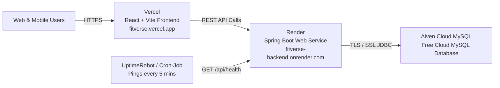

# FITVERSE — 24/7 Cloud Deployment Guide

This guide provides end-to-end instructions for deploying **FITVERSE** to stay online **24/7 continuously**, even when your laptop is turned off or closed.



---

## Architecture Summary
| Component | Platform | Plan | Purpose |
| :--- | :--- | :--- | :--- |
| **Frontend** | [Vercel](https://vercel.com) | Free Hobby | React 18 + Vite SPA with global CDN edge caching |
| **Backend** | [Render](https://render.com) | Free Web Service | Java 17 + Spring Boot 3 REST API in Docker |
| **Database** | [Aiven](https://aiven.io) | Free Tier MySQL | Fully managed cloud MySQL 8.0 with automatic SSL |
| **24/7 Keep-Alive** | [UptimeRobot](https://uptimerobot.com) | Free Monitor | Pings `/api/health` every 5 min to prevent sleep |

---

## Step 1: Push Local Code to Your GitHub Repository

1. Open your terminal in the project root:
   ```powershell
   cd c:\Users\nethr\OneDrive\Desktop\FITVERSE
   ```
2. Verify git status:
   ```powershell
   git status
   ```
3. Push your code to your remote GitHub repository:
   ```powershell
   git push -u origin main
   ```
   *(If prompted by Git Credential Manager or GitHub, log in with `nethrareddyjagirapu@gmail.com` or paste a GitHub Personal Access Token).*

---

## Step 2: Create Free Cloud MySQL on Aiven

1. Go to **[https://aiven.io](https://aiven.io)** and sign up / log in (using your GitHub account or email `nethrareddyjagirapu@gmail.com`).
2. Click **Create Service**.
3. Select **MySQL**.
4. Choose a cloud provider and region (e.g., **AWS** or **Google Cloud**, region closest to you like `ap-south-1 Mumbai` or `us-east-1`).
5. Select the **Free Tier** plan.
6. Set the Service Name to `fitverse-mysql` and click **Create Service**.
7. Wait 1–2 minutes for the service state to change to **Running**.
8. In the Service Overview page, note the **Connection Information**:
   - **Host** (e.g., `mysql-36xxxxxx-fitverse.aivencloud.com`)
   - **Port** (e.g., `12345`)
   - **User** (typically `avnadmin`)
   - **Password** (click the eye icon or copy)
   - **Database Name** (default is `defaultdb`)
   - **SSL Mode**: `REQUIRED`

### Your Spring Boot JDBC Connection URL:
```text
jdbc:mysql://<AIVEN_HOST>:<AIVEN_PORT>/defaultdb?sslMode=REQUIRED&serverTimezone=UTC
```
*(Replace `<AIVEN_HOST>` and `<AIVEN_PORT>` with your real Aiven host and port).*

> [!NOTE]
> When your Spring Boot backend starts on Render, **Flyway** automatically connects to Aiven and executes `V1__init_schema.sql` and `V2__seed_reference_data.sql`. All tables, food items, and exercise data will be initialized automatically!

---

## Step 3: Deploy Backend on Render as a Spring Boot Web Service

1. Go to **[https://render.com](https://render.com)** and sign in with GitHub (`nethrareddyjagirapu@gmail.com`).
2. Click **New +** → **Web Service**.
3. Under **Connect a repository**, select **`nethrareddyjagirapu-cloud/FITVERSE`**.
4. Configure the Web Service:
   - **Name**: `fitverse-backend`
   - **Region**: `Oregon (US West)` or `Frankfurt (EU Central)`
   - **Root Directory**: (leave empty)
   - **Runtime**: **Docker**
   - **Dockerfile Path**: `./backend/Dockerfile`
   - **Docker Build Context**: `./backend`
   - **Instance Type**: **Free**
5. Scroll down to **Environment Variables** and add the following keys:

| Key | Value | Notes |
| :--- | :--- | :--- |
| `PORT` | `8080` | Required internal port |
| `DB_URL` | `jdbc:mysql://<AIVEN_HOST>:<AIVEN_PORT>/defaultdb?sslMode=REQUIRED&serverTimezone=UTC` | Your Aiven JDBC URL |
| `DB_USERNAME` | `avnadmin` | Your Aiven username |
| `DB_PASSWORD` | `<your-aiven-password>` | Your Aiven password |
| `DB_DRIVER` | `com.mysql.cj.jdbc.Driver` | MySQL Connector/J driver |
| `SPRING_DATASOURCE_DRIVER_CLASS_NAME` | `com.mysql.cj.jdbc.Driver` | Spring Boot driver override |
| `CORS_ALLOWED_ORIGINS` | `https://*.vercel.app,http://localhost:5173` | Allowed frontend origins |
| `JWT_SECRET` | `FitverseSuperSecretKeyForJwtTokenGenerationMinimum256BitsLong2026!` | 256-bit JWT signing key |

6. Under **Advanced Settings**:
   - **Health Check Path**: `/api/health`
7. Click **Create Web Service**.
8. Render will build the Docker container and start your Spring Boot application.
9. Once live, Render displays your public backend URL, for example:
   ```text
   https://fitverse-backend-xxxx.onrender.com
   ```
10. Test the health check in your browser:
    ```text
    https://fitverse-backend-xxxx.onrender.com/api/health
    ```
    It will return:
    ```json
    {
      "status": "UP",
      "application": "FITVERSE API",
      "version": "1.0.0",
      "database": {
        "connected": true,
        "engine": "MySQL 8.0.x"
      }
    }
    ```

---

## Step 4: Deploy Frontend on Vercel Connected to GitHub

1. Go to **[https://vercel.com](https://vercel.com)** and log in with GitHub (`nethrareddyjagirapu@gmail.com`).
2. Click **Add New...** → **Project**.
3. Locate **`FITVERSE`** from your GitHub repositories and click **Import**.
4. In the **Configure Project** screen:
   - **Framework Preset**: `Vite`
   - **Root Directory**: Click **Edit** and choose `frontend`! *(CRITICAL STEP)*
   - **Build Command**: `npm run build` (default)
   - **Output Directory**: `dist` (default)
5. Expand **Environment Variables** and add:
   - **Key**: `VITE_API_BASE_URL`
   - **Value**: `https://fitverse-backend-xxxx.onrender.com/api` *(Your Render backend URL from Step 3 with `/api`)*
6. Click **Deploy**.
7. Vercel will build the frontend in ~30 seconds and provide your live production URL:
   ```text
   https://fitverse.vercel.app (or https://fitverse-xxxx.vercel.app)
   ```

---

## Step 5: Keep Online 24/7 (Preventing Sleep When Laptop Is Closed)

Render's free tier spins down web services after 15 minutes of inactivity. To keep your app **online 24/7/365 without sleep**:

1. Go to **[https://uptimerobot.com](https://uptimerobot.com)** (100% Free plan, 50 monitors).
2. Sign up and click **Add New Monitor**.
3. Fill in the monitor settings:
   - **Monitor Type**: `HTTP(s)`
   - **Friendly Name**: `FITVERSE Backend KeepAlive`
   - **URL (or IP)**: `https://fitverse-backend-xxxx.onrender.com/api/health`
   - **Monitoring Interval**: `5 minutes`
4. Click **Create Monitor**.

### How This Works:
- Every 5 minutes, UptimeRobot's cloud servers send an automated HTTP `GET` request to your backend's `/api/health` endpoint.
- Render receives this ping and detects ongoing active traffic.
- Render **never enters idle mode**, so the container never shuts down or goes to sleep.
- Your entire platform remains awake and accessible 24/7 across the globe, even when your personal laptop is completely closed and powered off!

---

## Step 6: Final Verification Checklist

- [ ] Visit your live Vercel URL (e.g. `https://fitverse.vercel.app`).
- [ ] Open DevTools (`F12` → **Network** tab).
- [ ] Sign up a new user or log in with demo account (`alex.fitness@fitverse.dev` / `Fitverse@2026`).
- [ ] Log a meal in the Nutrition section (e.g. 2 Rotis + Dal Tadka).
- [ ] Log a workout session in Workouts.
- [ ] Refresh the page — notice your logged data immediately loads from your persistent Aiven Cloud MySQL database!
- [ ] Check `/api/health` on Render to verify `status: UP` and `database.connected: true`.
